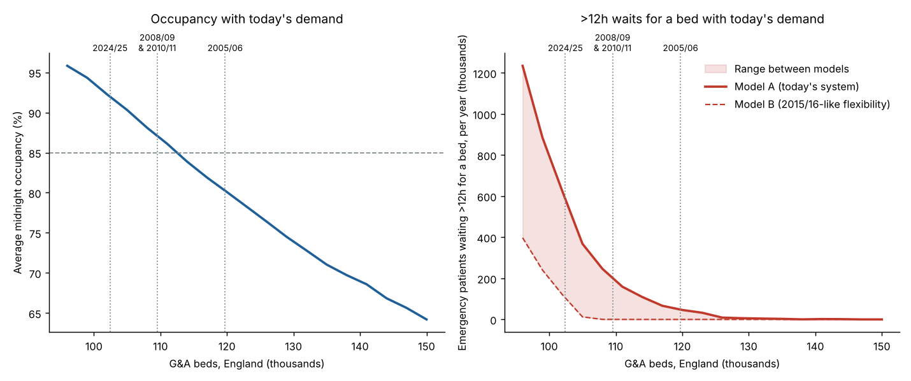
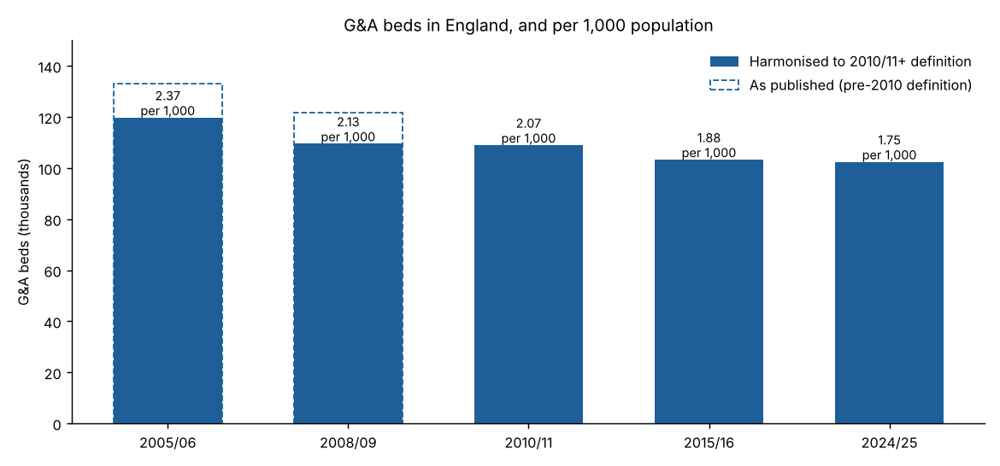
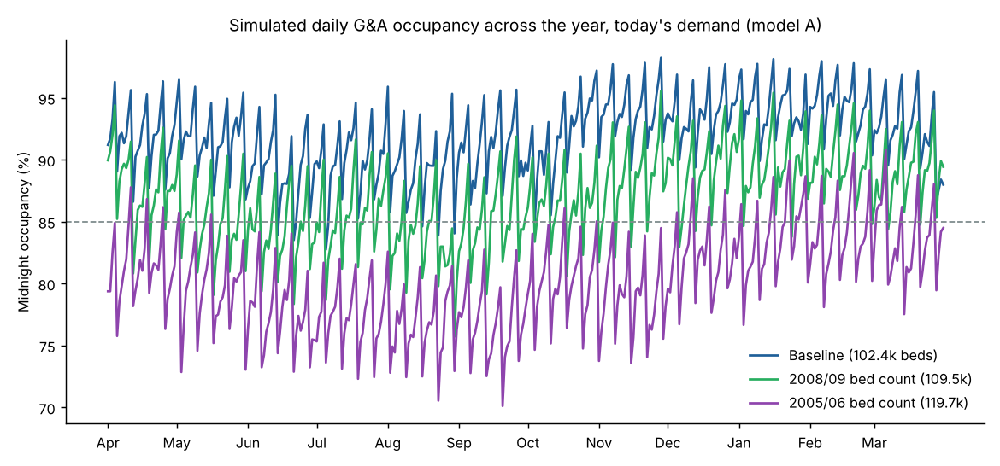

# Results: today's demand on historical bed numbers

**Question:** If England had the same number of general & acute (G&A) beds as in 2005/06, 2008/09, 2010/11 or 2015/16, what would bed occupancy and waits for a bed look like with today's (2024/25) demand?

**Status: first-pass results.** The model runs on national headline figures from published statistics, collected by web search (see `data/inputs/national_headline_figures.csv`). This environment could not download the raw NHS England, NHS Digital or ONS files. Several inputs are marked as assumptions in that file. Treat the numbers below as indicative.

## Headline findings

1. **G&A bed numbers have changed little since 2010; beds per head have fallen a lot.** On a consistent definition, England had ~119.7k G&A beds in 2005/06, ~109.5k in 2008/09, 109.0k in 2010/11, 103.3k in 2015/16 and 102.4k in 2024/25. Per 1,000 people that is 2.37 → 2.13 → 2.07 → 1.88 → 1.75, a fall of about 26% since 2005/06.
2. **Going back 10 years makes almost no difference.** 2015/16 had about the same number of beds as today, so today's demand on 2015/16 beds gives ~91.5% average occupancy (vs 92.0% now).
3. **2008/09 or 2010/11 bed numbers would bring average occupancy down to ~87%.** 2005/06 bed numbers would bring it to ~80%. Using the 2005/06 count as published under the old, wider definition, it would be ~72%.
4. **Waits for a bed fall much faster than occupancy.** In model A ("today's system"), patients waiting over 12 hours from decision to admit fall from ~530k a year to ~200–230k with 2008/09 or 2010/11 beds, and to ~43k with 2005/06 beds. In model B ("2015/16-like flexibility"), they fall to almost zero with any of those bed bases.
5. **Halving delayed discharges is worth about as much as going back to 2008/09 bed numbers.** It gives 87.8% occupancy and ~220k waits over 12 hours in model A. It frees the equivalent of ~7k beds.
6. **Demand growth since 2015/16 adds ~2.6 percentage points of occupancy.** 2015/16 demand on today's beds gives 89.4%.
7. **About 112k G&A beds (+~10k) would be needed for 85% average occupancy** at today's demand and today's delayed-discharge levels.

## Scenario table (today's demand unless stated)

| Scenario | G&A beds | Occupancy, model A | Occupancy, model B | >12h waits/yr, A | >12h waits/yr, B |
|---|---:|---:|---:|---:|---:|
| Baseline 2024/25 | 102,423 | 92.0% | 91.7% | ~529k | ~53k |
| 2015/16 bed count | 103,289 | 91.5% | 91.0% | ~453k | ~31k |
| 2010/11 bed count | 108,958 | 87.5% | 86.6% | ~231k | ~1k |
| 2008/09 bed count (harmonised) | 109,519 | 87.0% | 86.1% | ~204k | <1k |
| 2008/09 bed count (as published, old definition) | 121,688 | 79.0% | 77.3% | ~32k | 0 |
| 2005/06 bed count (harmonised) | 119,730 | 80.2% | 78.7% | ~43k | 0 |
| 2005/06 bed count (as published, old definition) | 133,033 | 72.2% | 70.8% | ~2k | 0 |
| 2015/16 beds per head | 110,451 | 86.3% | 85.5% | ~162k | ~1k |
| 2010/11 beds per head | 121,387 | 79.1% | 77.6% | ~32k | 0 |
| 2008/09 beds per head | 124,715 | 76.7% | 75.5% | ~20k | 0 |
| 2005/06 beds per head | 138,659 | 69.3% | 67.7% | ~1k | 0 |
| Delayed discharges halved (today's beds) | 102,423 | 87.8% | 86.5% | ~222k | <1k |
| Delayed discharges at 2015/16 level | 102,423 | 86.0% | 84.4% | ~160k | 0 |
| 2015/16 demand on today's beds | 102,423 | 89.4% | 89.5% | ~272k | ~3k |

The full outputs are in `outputs/scenarios.csv` and `outputs/bed_curve.csv`. A "static" check (today's occupied beds divided by scenario beds) is in the CSV and agrees with the simulation within ~1.5 points.

## How the model works

- **Discrete-event simulation** (`src/bedsim/des.py`). Emergency patients arrive with seasonal (±4%, peaking in January), weekday and hour-of-day patterns. 30% are same-day stays. The rest have a lognormal length of stay (median ~3 days, mean ~5). 20% of them then have a delayed discharge (mean ~4.3 days). Discharges happen 10:00–20:00, and half of weekend discharges slip to Monday. Elective overnight patients arrive on weekdays and are cancelled if no bed is free by 20:00. Emergency patients with no bed queue first-come-first-served, and that queue is the ">12h wait" measure.
- **Effective pool size.** Real beds are split across trusts, wards and specialties, so the national stock is modelled as many independent pools. The pool size is the key unknown:
  - **Model A** uses 92-bed pools. This was chosen so the model reproduces all three 2024/25 targets: 92.0% occupancy, delayed discharges ≈ 12.7% of occupied beds, and 8.1% of emergency admissions waiting over 12 hours from decision to admit.
  - **Model B** uses 1,000-bed pools. This reproduces the near-zero 12-hour waits of 2015/16 (about 0.02% of admissions).
- **Calibration** (`src/bedsim/calibrate.py`). For each model and year, length of stay and delay length are fitted by bisection so occupancy and delayed-discharge share match the observed figures.

## Important caveats

- **The back-test fails for waits, and that is a finding in itself.** Model A, fitted to 2024/25, predicts 4.1% of emergency admissions waiting over 12 hours in 2015/16; the observed figure was ~0.02%. Model B fits 2015/16 but predicts only 0.8% for 2024/25 (observed 8.1%). No single bed-pool structure explains both years. Today's hospitals produce far longer waits at a given occupancy than in 2015/16. NHS England has made the same point: post-pandemic bed configuration means pressure arises at lower occupancy. Possible causes include less flexible bed use, infection-control segregation, more variable demand, and changes in how waits are recorded. **Occupancy results are robust** (A and B agree within ~1–2 points). **Wait results should be read as the A–B range.**
- **Pre-2010 bed counts are approximate.** Before 2010/11, KH03 counted beds by ward type, annually. NHS England's method change reduced reported beds by ~10%. A 0.90 factor is applied to harmonise 2005/06 and 2008/09; the as-published figures are shown as an upper bound. The harmonised 2008/09 figure (109.5k) is close to the first new-definition year (109.0k in 2010/11), which suggests the bridge is reasonable.
- **Demand is "today's".** Scenarios hold 2024/25 admissions and lengths of stay fixed. They do not model how clinical practice would differ with more beds; for example, admission thresholds might fall, which would fill some of the extra beds.
- **Elective cancellations in model A (13% at baseline) are too high** compared with real on-the-day cancellations. In reality, a shortage of beds mostly shows up as fewer elective lists being planned. Treat this output as "elective capacity lost", not literal cancellations.
- **Inputs are headline national figures.** Some (overnight elective admissions, 2015/16 delayed discharge share, 2005/2010/2015 population) are approximations, flagged in the inputs CSV. 2024/25 beds and occupancy are taken from Q4 2024/25 and an assumed ~92% annual average.
- **Beds are assumed to be staffed.**

## Next steps

1. Allow network access to `england.nhs.uk`, `digital.nhs.uk` and `ons.gov.uk` (or commit the files) and replace the headline inputs with the KH03 time series (1987/88 onwards), daily sitreps, A&E, discharge-delay and HES length-of-stay tables.
2. Calibrate at trust level using the sitrep distributions, rather than one representative pool size.
3. Investigate the 2015/16 vs 2024/25 structural break (A vs B) directly using trust-level sitrep data, since it determines how much extra beds would reduce waits.
